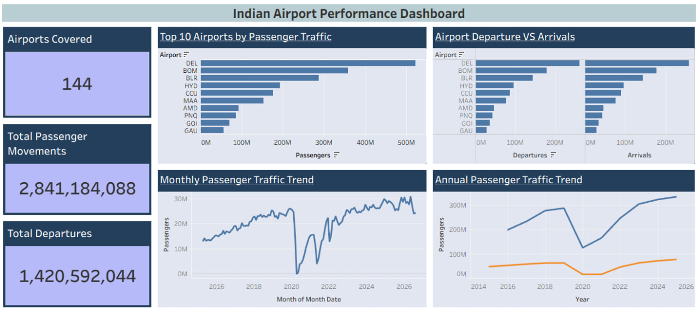
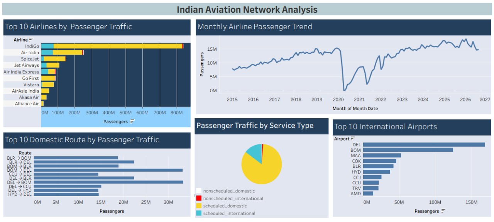

# Indian Aviation Analytics

An end-to-end data analytics project exploring passenger traffic, airport performance, airline activity and domestic and international aviation patterns in India.

## Project Overview

The Indian Aviation Analytics project focuses on analysing aviation passenger traffic and identifying patterns across airports, airlines, domestic routes and international airport operations.

The project combines Python-based exploratory data analysis (EDA) with interactive Tableau dashboards to transform raw aviation datasets into meaningful analytical insights.

## Project Objectives

- Analyse passenger traffic across Indian airports.
- Identify airports with the highest passenger movements.
- Examine monthly and annual passenger traffic trends.
- Compare domestic and international passenger traffic.
- Evaluate airline passenger traffic patterns.
- Identify the busiest domestic aviation routes.
- Explore international airport traffic distribution.
- Compare scheduled and non-scheduled aviation services.

## Tools & Technologies

- **Python:** Data analysis and exploratory data analysis.
- **Pandas:** Data manipulation and analysis.
- **Tableau:** Interactive dashboard development.
- **CSV:** Dataset storage and handling.

## Dataset Description

The project uses five datasets:

| Dataset | Description |
|---|---|
| `airport_monthly.csv` | Monthly airport-level passenger traffic, arrivals and departures. |
| `airport_yearly.csv` | Annual airport passenger traffic. |
| `carrier_monthly.csv` | Monthly airline passenger traffic by service type. |
| `domestic_route_monthly.csv` | Monthly passenger traffic across domestic routes. |
| `airport_international_quarterly.csv` | Quarterly international passenger traffic across airports. |

**Data Coverage:** Monthly airport and airline records span January 2015 to August 2026. Other datasets have their respective reporting periods.

## Exploratory Data Analysis

Python was used to explore the datasets and examine:

- Airport-level passenger traffic distribution.
- Monthly and annual passenger movement patterns.
- Airline-level traffic comparisons.
- Domestic route traffic rankings.
- International airport traffic distribution.

## Tableau Dashboards

### 1. Indian Airport Performance Dashboard

This dashboard explores airport-level passenger activity through:

- Top 10 airports by passenger traffic.
- Airport departures versus arrivals.
- Monthly passenger traffic trends.
- Annual domestic and international passenger traffic trends.

### 2. Indian Aviation Network Analysis Dashboard

This dashboard focuses on airline and aviation network patterns through:

- Top 10 airlines by passenger traffic.
- Monthly airline passenger trends.
- Top 10 domestic routes by passenger traffic.
- Top international airports.
- Passenger traffic distribution by service type.

## Key Analytical Insights

*Numerical findings and observations will be added after validating the results from the exploratory analysis.*

The analysis will focus on identifying passenger traffic concentration, temporal patterns, leading airlines, high-traffic domestic routes and international airport activity.

## How to Explore the Project

1. Browse the Python scripts in the `Exploration` folder.
2. Review the datasets in the `Data` folder.
3. View the dashboard screenshots in the `Screenshots` folder.
4. Download the Tableau Packaged Workbook (`.twbx`) from the `Tableau` folder to explore the interactive dashboards.

## Data Limitations

- Passenger traffic represents passenger movements, not unique individual passengers.
- Monthly data for 2026 is partial and currently extends through August.
- Annual domestic passenger coverage for 2015 is incomplete; therefore, direct year-on-year comparisons involving 2015 require caution.
- International quarterly data for 2026 contains only two quarters.
- The analysis does not measure airline profitability, operational costs, punctuality or seat capacity.

## Project Focus

This project demonstrates practical skills in data cleaning, exploratory data analysis, analytical thinking, data visualisation and dashboard development using Python and Tableau.
